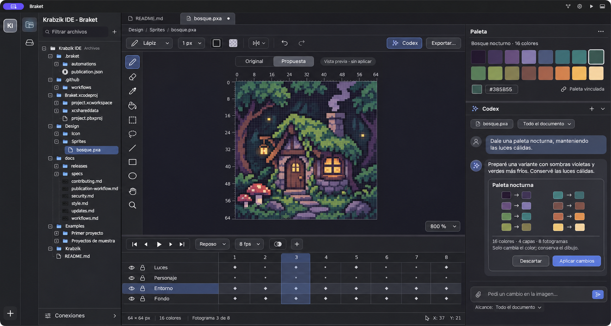

# Editor de pixel art · Etapa 2: integración en Braket

| | |
|---|---|
| **Estado** | Especificado; pendiente de implementación y validación |
| **Fecha** | 2026-11-14 |
| **Área** | Espacio de trabajo, UI, documentos, guardado y recuperación |
| **Depende de** | Contratos PXA-01 a PXA-04 de la [etapa 1](README.md) |
| **Autorización actual** | Solo documentación; no programar, compilar ni instalar |

## Objetivo

Entregar, cuando se implemente esta etapa, un documento `.pxa` integrado en la ventana de Braket:
crear, abrir, inspeccionar, navegar su historial, guardar, cerrar y recuperar sin pérdida de datos.
La distribución debe corresponder al mockup acordado, adaptándose al tamaño de ventana y al tema.

La etapa construye el espacio de trabajo real. Las herramientas de dibujo, edición de paleta,
animación, exportación e inferencia de Codex se habilitan en sus etapas respectivas. No se mostrarán
conversaciones ficticias ni propuestas simuladas como funciones disponibles.

## Referencia visual acordada

Copia del mockup generado y aceptado en la conversación del 2026-11-14, basada en una captura de
la app instalada. Es una propuesta visual del producto final, no una captura de funciones ya
implementadas. La imagen de ejemplo y sus números no son fixtures ni medidas normativas; las
reglas de datos y dimensiones son las de los specs. Se conserva aquí para que la revisión no
dependa de acceder al chat o a una ruta personal de imágenes generadas.

## Especificaciones

| Spec | Responsabilidad |
|---|---|
| [PXA-05](PXA-05-integracion-documentos.md) | Tipo de documento, creación/apertura, pestañas, Finder y contexto sin proyecto |
| [PXA-06](PXA-06-interfaz-editor.md) | Layout, lienzo, paneles, foco, navegación, estados y accesibilidad |
| [PXA-07](PXA-07-guardado-y-cierre.md) | Guardar/Guardar como/Copia, cambios externos y cierre consistente |
| [PXA-08](PXA-08-recuperacion-y-sesion.md) | Recuperación local, restauración de sesión y coordinación con el archivo original |

PXA-01 sigue siendo la autoridad del formato y PXA-02 la del historial. Estos specs concretan su
comportamiento en la app sin crear una segunda versión del contenedor ni modificar `.kzk`.

## Funcionalidad entregable y límites de etapa

| Área | Funciona al terminar la etapa 2 | Se habilita después |
|---|---|---|
| Documento | Nuevo lienzo transparente, abrir y validar `.pxa`, identidad y pestañas | Importación PNG/hojas de sprites: etapa 6 |
| Lienzo | Render correcto del fotograma, zoom, pan, cuadrícula y selección guardada visible | Dibujar/seleccionar/transformar: etapa 3 |
| Capas/fotogramas | Inspeccionar propiedades y elegir celda/fotograma sin editar su contenido | Edición de capas: 3; edición/reproducción de animación: 5 |
| Paleta | Ver RGBA, IDs, nombres, usos y vínculos, elegir color activo | Edición/conversión de paletas: 4 |
| Historia | Ver revisiones/ramas, deshacer/rehacer y restaurar revisión existente | Nuevas operaciones artísticas: 3 en adelante |
| Archivos | Guardado completo, copia, conflictos, recuperación y restauración | Exportar imágenes/animaciones: 6 |
| Codex | Ubicación del panel y lectura de datos ya persistidos | Conectar, enviar, revisar/aplicar propuestas: 7 |

La etapa requiere lector, escritor, validador, renderer y navegación del historial funcionales.
Se implementarán al autorizar código; los specs de etapa 1 no son una implementación existente.
Un documento creado aquí empieza vacío y no se promete poder dibujar hasta la etapa 3.

## Secuencia interna futura

1. Implementar/adaptar los servicios del modelo de etapa 1 y una variante documental tipada.
2. Integrar apertura, borradores, pestañas y render, con datos de prueba válidos.
3. Completar layout, navegación y estado por documento.
4. Incorporar guardado/cierre, cambios externos y recuperación como un conjunto; no entregar
   edición de historial con persistencia insegura mientras se espera a un incremento posterior.
5. Integrar rutas de Finder, contexto sin proyecto y restauración, y verificar regresiones.

Cada incremento es interno a la etapa. El hito usable exige el conjunto, incluidas las salidas de error.

## Decisiones de integración

- Una única ventana e instancia de Braket. Cada `.pxa` abre una pestaña, no una app separada.
- La línea de tiempo pertenece al documento; no reemplaza el panel global de procesos/SQL.
- Se conserva el explorador y las barras laterales existentes. El inspector de pixel art vive
  dentro de la superficie del documento activo.
- Un `.pxa` abierto sin `.kzk` usa un contexto temporal **Archivos sueltos**, sin crear un proyecto
  en disco ni escanear su carpeta. Es un alojamiento mínimo para documentos `.pxa`, no otro IDE.
- En etapa 2, Codex es un panel preparado para integración, sin solicitudes ni autenticación nuevas.
- No se alteran los atajos globales actuales de abrir proyecto, zoom de interfaz o procesos.
- No se usa la identidad de una conexión SQL para cerrar, guardar o localizar un documento gráfico.

## Recorrido de aceptación principal

1. Crear un documento de 64 × 64, nombrarlo y guardarlo desde el editor en una carpeta elegida.
2. Abrir un fixture `.pxa` con píxeles libres/vinculados, varias capas/fotogramas e historia ramificada.
3. Alternar con pestañas de texto, Markdown y SQL; recuperar vista y documento activos sin reiniciar estados.
4. Navegar a una revisión anterior, guardar, cerrar y reabrir; verificar el cursor y el rehacer retenido.
5. Cambiar el original externamente; comprobar que no se sobrescribe al guardar un estado local distinto.
6. Interrumpir la app con trabajo confirmado aún no guardado y restaurar desde recuperación local.
7. Abrir un `.pxa` desde Finder sin proyecto; no crear `.kzk`, duplicar ventanas ni iniciar procesos.

Pruebas y revisión visual se detallan en cada spec. Todo lo anterior está pendiente de ejecución.

## Entrega futura

La validación visual de implementación se hará únicamente con `/Applications/Braket.app`, después
de compilar/verificar Release, respaldar e instalar, conforme a `AGENTS.md`. Un `.app` generado
en `.build` no cuenta como entrega. Este trabajo documental no requiere compilar ni instalar.
